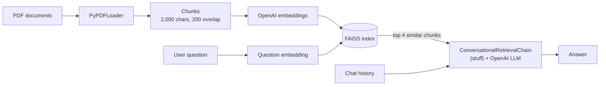

[README.md](https://github.com/user-attachments/files/33626943/README.md)
# Customer Retention RAG Chatbot

A Retrieval-Augmented Generation (RAG) chatbot for telecom customer retention. It answers questions from your own PDF documents (plans, offers, retention policies) instead of relying on the model's general knowledge, and it keeps the conversation history so follow-up questions work.

Built with **LangChain**, **OpenAI** embeddings and LLM, **FAISS** vector search and a **Flask** API with a small web interface.

## How it works



1. **Load:** `DirectoryLoader` with `PyPDFLoader` reads every PDF in `documents/`.
2. **Split:** `CharacterTextSplitter` cuts the text into 2,000-character chunks with a 200-character overlap, so context is not lost at chunk boundaries.
3. **Embed and index:** OpenAI embeddings turn each chunk into a vector, and FAISS stores them for similarity search.
4. **Retrieve:** the user's question is embedded and the closest chunks (LangChain's default retriever returns the top 4) are fetched from FAISS.
5. **Generate:** `ConversationalRetrievalChain` (chain type `stuff`) rewrites the question using the chat history, places the retrieved chunks in one prompt, and the LLM answers from them.
6. **Serve:** Flask exposes the chain through a REST endpoint and a browser chat page.

## Tech stack

| Layer | Tool |
|---|---|
| Orchestration | LangChain |
| Embeddings and LLM | OpenAI (`langchain-openai`) |
| Vector search | FAISS (CPU) |
| PDF parsing | `pypdf` via `PyPDFLoader` |
| API and UI | Flask, HTML/JavaScript |
| Configuration | `python-dotenv` |

## Project structure

```
customer-retention-rag-chatbot/
├── GenAI_Cap.py        # builds the RAG pipeline (load, split, embed, index, chain)
├── GenAI_Cap_Bot.py    # Flask app: web page, /get_answer, /clear_chat
├── templates/
│   └── index.html      # chat interface
├── documents/          # put your PDFs here (not tracked by Git)
├── requirements.txt
├── .env.example        # copy to .env and add your key
├── .gitignore
├── LICENSE
└── README.md
```

## Getting started

**Prerequisites:** Python 3.10 or later and an [OpenAI API key](https://platform.openai.com/api-keys).

```bash
# 1. Clone the repository
git clone https://github.com/mayankraj2703/customer-retention-rag-chatbot.git
cd customer-retention-rag-chatbot

# 2. Create and activate a virtual environment
python -m venv .venv
source .venv/bin/activate        # Windows: .venv\Scripts\activate

# 3. Install dependencies
pip install -r requirements.txt

# 4. Add your API key
cp .env.example .env             # Windows: copy .env.example .env
# then open .env and set OPENAI_API_KEY

# 5. Add at least one PDF to the documents/ folder

# 6. Run the app
python GenAI_Cap_Bot.py
```

Open http://127.0.0.1:5000 in your browser.

The app stops with a clear error if `OPENAI_API_KEY` is missing or if `documents/` has no PDFs. The index is rebuilt each time the app starts, so restart it after adding or changing documents.

## API

| Endpoint | Method | Body | Returns |
|---|---|---|---|
| `/` | GET | none | chat page |
| `/get_answer` | POST | `{"question": "..."}` (JSON) or form field `question` | `{"answer": "..."}` |
| `/clear_chat` | POST | none | `{"message": "Conversation history cleared."}` |

```bash
curl -X POST http://127.0.0.1:5000/get_answer \
  -H "Content-Type: application/json" \
  -d '{"question": "What offers are available for customers who want to cancel?"}'
```

## Evaluation

> TODO before publishing: run 20–30 questions whose answers you know from your documents, then fill in this table or delete the section. Do not leave placeholders in a public repo.

| Measure | Result |
|---|---|
| Documents in knowledge base | [M] |
| Test questions | [N] |
| Correct answers | [X] ([Y]%) |
| Partly correct | [P] |
| Wrong or unsupported | [W] |
| Average response time | [Z] seconds |

## Limitations

- **One shared conversation.** Chat history is a single global list, so every visitor shares it. This is fine for a local demo, but a multi-user deployment needs per-session history.
- **No custom prompt.** The chain uses LangChain's default prompts, so retention behavior depends on the content of your documents.
- **Answer quality depends on the documents.** Scanned PDFs without a text layer cannot be read, and questions outside the documents may get a weak or invented answer.
- **No authentication or rate limiting.** Do not expose the app publicly as is.
- **Index rebuilt on every start,** which costs embedding calls for large document sets.

## Possible improvements

- Per-session chat history
- Custom system prompt that recommends the relevant retention offer when a customer mentions cancelling
- Source citations (show which document and page an answer came from)
- Saving the FAISS index to disk to avoid re-embedding
- Automated evaluation set for regression testing

## Security notes

Keep your key in `.env`, which is excluded by `.gitignore`. If a key is ever committed, revoke it immediately in the OpenAI dashboard; removing it from a later commit does not remove it from Git history.

## Author

**Mayank Raj Pachouri** · Data Scientist · [LinkedIn](https://www.linkedin.com/in/mayankraj2703) · mayankraj.mr@gmail.com

Released under the [MIT License](LICENSE).
